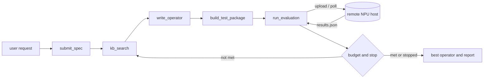

# CANNESS

**An agent plugin for Ascend CANN operator development**, delivered as a [DeepSeek Harness](https://github.com/deepseek-ai/deepseek-harness) (dsh) plugin.

It hands the loop — *submit a spec → generate the four operator layers → package a test bundle → upload it → wait for the evaluation → iterate within a budget* — to dsh's agent loop. CANNESS only owns the domain contract.

[](CHANGELOG.md)
[](LICENSE)
[](https://nodejs.org/)
[](https://github.com/deepseek-ai/deepseek-harness)
[](plugin/tests)

[简体中文](README.md) | **English**

---

## Table of contents

- [1. Why CANNESS](#1-why-canness)
- [2. Features](#2-features)
- [3. Architecture](#3-architecture)
- [4. A complete round](#4-a-complete-round)
- [5. Requirements](#5-requirements)
- [6. Quick start](#6-quick-start)
- [7. Tool reference](#7-tool-reference)
- [8. Configuration reference](#8-configuration-reference)
- [9. Remote contract](#9-remote-contract)
- [10. Authentication and credentials](#10-authentication-and-credentials)
- [11. Workspace layout](#11-workspace-layout)
- [12. Development](#12-development)
- [13. Limitations and roadmap](#13-limitations-and-roadmap)
- [14. FAQ](#14-faq)
- [15. Documentation](#15-documentation)
- [16. License](#16-license)

## 1. Why CANNESS

AscendC operator development has a long loop: write a spec → implement the kernel / host / api / plugin layers → compile → verify accuracy and performance → read msprof data → change the code. The expensive part is not any single compile, but the **manual shuttling in every round**: copying files, logging into a machine, waiting, reading logs, deciding what to change next.

CANNESS gives that loop to an agent, with sharp boundaries:

| Owner | Responsibility |
|---|---|
| **dsh** | CLI, configuration, LLM routing, agent orchestration, session log, Web UI, credential store |
| **CANNESS plugin** | Domain contract: spec, four-layer files, test package, evaluation report, knowledge base, iteration budget |
| **Remote host** | Actually runs the compile, accuracy check, performance collection and msprof |

Nothing is compiled locally, no CANN call is made locally, and no cloud API is involved. Evaluation happens on your own machine with the CANN toolchain; CANNESS only requires that it accepts SSH and that somebody consumes the inbox.

## 2. Features

- **Spec-driven** — `submit_spec` validates field by field. A missing field fails with its path (`missing performance_target.metric`) and writes no half-baked state, so the model turns around and asks the user.
- **Four-layer output** — `write_operator` writes `op_kernel`, `op_host`, `op_api` and `op_plugin` in one call.
- **Self-contained test package** — `build_test_package` copies the four layers and adds a `manifest.json`; the remote side can compile it as-is.
- **Plain SSH transport** — SFTP upload plus result polling over `ssh2`, with private-key or password authentication; the password lives in dsh's credential store.
- **Budget and stop conditions** — valid iterations, compile retries, timeouts, performance regression streak, convergence and target met are judged independently.
- **Automatic continuation** — `canness-loop` steers another round carrying the evaluation context from `agent/turn-stopping`, without the user pushing it.
- **Performance analysis built in** — msprof-shaped `analysis` (bottleneck, MAC/MTE2/Scalar ratios, cube utilization) is parsed and fed straight into the retry prompt.
- **Web settings card** — Settings → CANNESS edits host, paths and budget; saves take effect immediately (volatile config) with no restart.
- **Replayable** — every tool call and result lands in the dsh session log: model-visible means logged.

## 3. Architecture

```
┌───────────────────────────── dsh (deepseek-harness) ─────────────────────────────┐
│  CLI · layered config · LLM routing · session log · Web UI · credentials         │
│                                                                                  │
│  agent loop ──► tool pipeline ──► event bus (agent/pre-step, agent/turn-stopping)│
│  tool registry · live config · session log · credential store                    │
└────────────────────────────────────────▲─────────────────────────────────────────┘
                                         │  tool calls / results / events
┌────────────────────────────────────────┴─────────────────────────────────────────┐
│ dsh-canness (bundle)                                                             │
│                                                                                  │
│  canness-knowledge  ──► kb_search                                                │
│  canness-generator  ──► submit_spec · write_operator · build_test_package        │
│  canness-eval       ──► run_evaluation ──── SFTP ────► remote NPU host           │
│  canness-loop       ──► budget and stop policy (two event listeners)             │
│  canness (client)   ──► Web settings card                                        │
└──────────────────────────────────────────────────────────────────────────────────┘
```

### Bundled plugins

| Plugin id | Entry | Tools registered | Events listened |
|---|---|---|---|
| `canness` | `dsh-canness` | — | — (the anchor row for the browser half) |
| `canness-knowledge` | `dsh-canness/knowledge` | `kb_search` | — |
| `canness-generator` | `dsh-canness/generator` | `submit_spec`, `write_operator`, `build_test_package` | — |
| `canness-eval` | `dsh-canness/eval` | `run_evaluation` | — |
| `canness-loop` | `dsh-canness/loop` | — | `agent/pre-step`, `agent/turn-stopping` |

The four host plugins share `{workspace}/.canness/state.json`. The `canness` row carries no logic, but the browser half attaches only to the bare-package-name row — remove it and the settings card disappears.

### Who controls what

The model only decides *what to do next*; all three gates live in code:

| Gate | Carrier | Purpose |
|---|---|---|
| Tool validation | tool parameter schemas | What is allowed (e.g. no `write_operator` before `submit_spec`) |
| Event listeners | `agent/pre-step` / `agent/turn-stopping` | What context to inject, whether to run another round |
| Service rules | `policy.ts` | What counts as a valid iteration, when to stop |

## 4. A complete round



1. The user states a need: “Add, float16, 910B, kernel_time ≤ 8us”.
2. `submit_spec` validates the spec, mints a `generationId` (e.g. `gen-1a2b3c4d`) and writes the state file.
3. `kb_search` retrieves reference implementations and tiling hints by operator name.
4. `write_operator` writes the four layers to `{workspace}/operators/<generationId>/`.
5. `build_test_package` assembles `{workspace}/packages/<generationId>/` with a `manifest.json`.
6. `run_evaluation` uploads to `{inbox}/<generationId>/`, polls `{outbox}/<generationId>/results.json` and returns the parsed report as the tool result.
7. `canness-loop` decides whether to steer another round, carrying the failure context in an enhancement block.

## 5. Requirements

| Dependency | Version | Notes |
|---|---|---|
| Node.js | `>= 24.9.0` | Plugin runtime |
| pnpm | `>= 10` | Tested with `11.28.5` |
| dsh | `>= 0.2.0 < 0.3.0` | Reference version `0.2.1-rc.3` |
| Remote host (optional) | Linux + sshd | Real CANN / msprof optional; not needed for the mock |

dsh may come from either source; both command forms are given below:

- **Installed CLI**: `dsh ...`
- **dsh source checkout**: `pnpm dsh ...`, after `pnpm install && pnpm run build` in that checkout

> On **Windows**, Git Bash is recommended. `dsh plugin add` accepts both relative and absolute paths; this document uses absolute paths throughout to avoid ambiguity.

## 6. Quick start

Five steps: build the plugin → prepare a profile → pin absolute paths → start → verify.

### 6.1 Clone and build

```bash
git clone https://github.com/Hanerson/CANNESS.git
cd CANNESS/plugin
pnpm install
pnpm test
pnpm build
```

`pnpm build` compiles the host half (`lib/*.js`) and bundles the browser half with esbuild (`lib/client.js`). dsh loads `lib/`, so **every source change needs a rebuild**. `lib/` and `node_modules/` are gitignored — you must build after cloning.

### 6.2 Prepare a profile with the Web UI

Installing a dsh plugin means linking the package into a profile and adding its name to that profile's `dsh.profile.bundles`. `dsh plugin add` does both.

Create a dedicated profile from the `web` template:

```bash
# installed CLI
dsh --profile canness-web --from-default-profile web --dump-config

# or, from a dsh source checkout
pnpm dsh --profile canness-web --from-default-profile web --dump-config
```

`--dump-config` only creates the profile and prints the composed configuration; it does not start the server.

Then install the plugin (replace the path with your clone):

```bash
# installed CLI
dsh plugin --profile canness-web add /abs/path/to/CANNESS/plugin

# or, from a dsh source checkout
pnpm dsh plugin --profile canness-web add /abs/path/to/CANNESS/plugin
```

Windows example:

```bash
pnpm dsh plugin --profile canness-web add D:/projects/CANNESS/plugin
```

After a successful install, `~/.dsh/profiles/canness-web/package.json` lists `dsh-canness` in `bundles`:

```json
["@deepseek-ai/dsh-base", "@deepseek-ai/dsh-web-app", "dsh-canness"]
```

> pnpm prints unresolved peerDependency warnings. That is expected: dsh provides those peers at runtime and they are not installed into the profile.

### 6.3 Pin absolute paths at the profile layer

The bundle's own [`plugin/cordis.patch.yml`](plugin/cordis.patch.yml) uses relative paths:

```yaml
kbRoot: ./plugin/knowledge_base
workspace: ./canness-workspace
```

They resolve against the **dsh process cwd**, which points at the wrong directory when dsh starts elsewhere. Put this into `~/.dsh/profiles/canness-web/cordis.patch.yml` (replace paths with your checkout):

```yaml
# dsh replaces the whole config of a patched row, so every key must be restated.
- id: canness-knowledge
  config:
    kbRoot: /abs/path/to/CANNESS/plugin/knowledge_base

- id: canness-generator
  config:
    workspace: /abs/path/to/CANNESS/canness-workspace

- id: canness-eval
  config:
    workspace: /abs/path/to/CANNESS/canness-workspace
    host: ''
    port: 22
    username: ''
    privateKeyPath: ''
    inbox: /tmp/canness/inbox
    outbox: /tmp/canness/outbox
    timeoutSec: 1800
    pollIntervalMs: 2000
    maxIterations: 10
    maxCompileRetries: 3
    negativeStreakLimit: 3
    convergenceThreshold: 0.05

- id: canness-loop
  config:
    workspace: /abs/path/to/CANNESS/canness-workspace
    maxIterations: 10
    maxCompileRetries: 3
    negativeStreakLimit: 3
    convergenceThreshold: 0.05
```

`canness-workspace/` is created on the first operator generation. Alternatively skip this file and fill the fields in **Settings → CANNESS** after starting — the card writes exactly this patch.

### 6.4 Start

```bash
# installed CLI
dsh --profile canness-web

# or, from a dsh source checkout
pnpm dsh canness-web
```

The terminal prints `dsh web: http://127.0.0.1:<port>/?token=...`; open it in a browser. Useful flags: `--no-open` (do not open a browser), `--port 0` (pick a free port), `--host 127.0.0.1` (bind address).

### 6.5 Verify

```bash
dsh --profile canness-web --dump-config | grep -A 8 "== dsh-canness"
```

You should see five rows: `canness`, `canness-knowledge`, `canness-generator`, `canness-eval`, `canness-loop`.

After starting, **Settings → CANNESS** should show the settings card; asking the model to call `kb_search` confirms the plugin is loaded.

## 7. Tool reference

### `kb_search`

| Parameter | Type | Required | Description |
|---|---|---|---|
| `operator_name` | string | yes | Operator name, e.g. `Add` |

Returns the concatenated bodies of matching entries, capped at 8000 characters. Matching is a **case-insensitive filename substring** test, e.g. `Add.md`. A miss returns `no knowledge entry for <name>`.

### `submit_spec`

| Parameter | Type | Required | Description |
|---|---|---|---|
| `spec` | JSON | yes | Operator specification |

Returns `{ generationId, operator_name }`. A validation failure throws `missing <field path>`, e.g. `missing performance_target.metric`, and writes no state.

```json
{
  "operator_name": "Add",
  "operator_type": "elementwise",
  "input_specs": [
    { "name": "x", "shape": ["B", "N"], "dtype": "float16" },
    { "name": "y", "shape": ["B", "N"], "dtype": "float16" }
  ],
  "output_specs": [
    { "name": "z", "shape": ["B", "N"], "dtype": "float16" }
  ],
  "target_platform": { "chip": "Ascend910B", "soc_version": "Ascend910B4" },
  "performance_target": { "metric": "kernel_time", "target_us": 8 },
  "tiling_hints": "tile B*N by 8192, double-buffer in UB"
}
```

| Field | Required | Constraint |
|---|---|---|
| `operator_name` / `operator_type` | yes | Non-empty string |
| `input_specs` / `output_specs` | yes | Non-empty array; each item needs `name`, `shape` (string array), `dtype`; `constraints` optional |
| `target_platform.chip` | yes | Non-empty string; `soc_version`, `cann_version` optional |
| `performance_target.metric` | yes | Only `kernel_time` is accepted today |
| `performance_target.target_us` | yes | Finite positive number |
| `tiling_hints` | no | String or `null` |

### `write_operator`

| Parameter | Type | Required | Description |
|---|---|---|---|
| `kernel` | string | yes | Body of `op_kernel/kernel.cpp` |
| `host` | string | yes | Body of `op_host/host.cpp` |
| `api` | string | yes | Body of `op_api/api.cpp` |
| `plugin` | string | yes | Body of `op_plugin/plugin.py` |

Returns `{ operatorDir }`. Fails with `submit_spec first` when no spec was submitted.

### `build_test_package`

No parameters. Returns `{ packageDir }`. Copies the current generation's four layers and writes `manifest.json`:

```json
{
  "generationId": "gen-1a2b3c4d",
  "operatorName": "Add",
  "performanceTargetUs": 8,
  "files": ["op_kernel/kernel.cpp", "op_host/host.cpp", "op_api/api.cpp", "op_plugin/plugin.py"]
}
```

### `run_evaluation`

No parameters. Returns an evaluation report (see [9.2](#92-result-file)). These cases do **not** throw; they return a report with `status: "error"`: empty `host`, missing credentials, SSH connection failure, budget exhausted. These cases throw: no `submit_spec` (`submit_spec first`), no `build_test_package` (`build_test_package first`).

## 8. Configuration reference

Configuration for the four host plugins. Except `workspace`, every `canness-eval` field is **volatile** — a card save is visible to the next operation without a restart.

### `canness-knowledge`

| Field | Type | Description |
|---|---|---|
| `kbRoot` | string | Knowledge base directory. The bundle defaults to `./plugin/knowledge_base` |

### `canness-generator`

| Field | Type | Description |
|---|---|---|
| `workspace` | string | Workspace root; the state file and artifacts live here |

### `canness-eval`

| Field | Type | Default | Description |
|---|---|---|---|
| `workspace` | string | — | Workspace root |
| `host` | string | `""` | Remote hostname or IP; when empty, `run_evaluation` returns an error report |
| `port` | number | `22` | SSH port |
| `username` | string | `""` | SSH user |
| `privateKeyPath` | string | `""` | Private key path; takes priority when non-empty |
| `passwordEnv` | string | `CANNNESS_SSH_PASSWORD` | Credential-store reference used to resolve the password |
| `inbox` | string | `/tmp/canness/inbox` | Remote directory receiving test packages |
| `outbox` | string | `/tmp/canness/outbox` | Remote directory receiving results |
| `timeoutSec` | number | `1800` | Longest wait for `results.json`, in seconds |
| `pollIntervalMs` | number | `2000` | Delay between result polls |
| `maxIterations` | number | `10` | Valid-iteration limit |
| `maxCompileRetries` | number | `3` | Consecutive compile-failure limit |
| `negativeStreakLimit` | number | `3` | Consecutive performance-regression limit |
| `convergenceThreshold` | number | `0.05` | Two passes within this relative difference count as converged |

### `canness-loop`

`workspace` plus the same four budget fields as `canness-eval`.

> **The budget is written twice and the numbers must match.** `canness-eval` uses it to reject over-budget calls and to decide stopping; `canness-loop` uses it to decide whether to steer. Mismatched values produce “the tool refuses but the loop keeps steering”.

### Stop conditions

| Condition | Threshold | `lastReport.summary` |
|---|---|---|
| Accumulated timeouts | `timeouts >= 2` (fixed) | `stopped: timeouts` |
| Compile-failure streak | `compileRetries >= maxCompileRetries` | `stopped: compileRetries` |
| Valid iterations | `validIterations >= maxIterations` | `stopped: maxIterations` |
| Performance regressions | `negativeStreak >= negativeStreakLimit` | `stopped: negativeStreak` |
| Convergence | relative difference of two passes `< convergenceThreshold` | `stopped: converged` |
| Target met | `kernelTimeUs <= targetUs` (latest report is `pass`) | `stopped: targetMet` |

### Counting rules

| Report status | Valid iterations | Other counters |
|---|---|---|
| `compile_fail` | unchanged | `compileRetries + 1` |
| `timeout` | unchanged | `timeouts + 1` |
| `pass` | +1 | `negativeStreak` reset; last and previous pass times recorded; best refreshed |
| `accuracy_fail` / `perf_fail` / `error` | +1 | Faster than the best → best refreshed and streak reset; otherwise `negativeStreak + 1` |

## 9. Remote contract

### 9.1 Layout

```
{inbox}/{generationId}/op_kernel/kernel.cpp
{inbox}/{generationId}/op_host/host.cpp
{inbox}/{generationId}/op_api/api.cpp
{inbox}/{generationId}/op_plugin/plugin.py
{inbox}/{generationId}/manifest.json

{outbox}/{generationId}/results.json
```

Each round deletes the previous `results.json` before polling, so a stale result is never read.

**Something must consume the inbox.** How the remote starts compiling and evaluating is entirely up to the host — directory watcher, cron, or a long-running runner. CANNESS only uploads and waits; it executes no commands over SSH.

### 9.2 Result file

```json
{
  "generationId": "gen-1a2b3c4d",
  "status": "pass",
  "compile": { "ok": true, "log": "" },
  "correctness": { "ok": true, "maxRelativeError": 0.0004 },
  "performance": { "kernelTimeUs": 7.6, "targetUs": 8 },
  "analysis": {
    "source": "msprof",
    "bottleneck": "memory",
    "summary": "Task Duration 7.6us; aic_mte2_ratio 0.71, memory-bound, cube_utilization 21.3%.",
    "op": {
      "opName": "Add",
      "opType": "Add",
      "taskType": "AI_CORE",
      "taskDurationUs": 7.6,
      "taskWaitTimeUs": 2,
      "blockDim": 8,
      "aicoreTimeUs": 7.6,
      "aicMacRatio": 0.12,
      "aicMte2Ratio": 0.71,
      "aicScalarRatio": 0.09,
      "cubeUtilizationPct": 21.3
    }
  },
  "summary": "passed"
}
```

| Field | Constraint |
|---|---|
| `status` | One of `pass`, `compile_fail`, `accuracy_fail`, `perf_fail`, `timeout`, `error` |
| `compile` | `ok` boolean, `log` string (truncated to 2000 characters when it enters the enhancement block) |
| `correctness.maxRelativeError` | Number or `null` |
| `performance.kernelTimeUs` / `targetUs` | Number or `null` |
| `analysis` | May be `null`; `source` ∈ `msprof`, `msprof-mock`; `bottleneck` ∈ `cube`, `memory`, `scalar`, `unknown`; `op` may be `null` |

An invalid result does not throw: it produces `status: "error"` with `summary: "malformed result: <reason>"` so the loop keeps going instead of aborting.

### 9.3 Remote mock

Without a CANN environment, [`plugin/remote/watch.py`](plugin/remote/watch.py) fakes the evaluation. Copy it to the remote and run it from cron or by hand:

```bash
python3 watch.py --inbox /tmp/canness/inbox --outbox /tmp/canness/outbox --once
```

It scans `{inbox}/*/manifest.json` and writes a `status: "pass"` result per generation with `analysis.source: "msprof-mock"` and `kernelTimeUs` taken from `manifest.performanceTargetUs`. It never calls msprof and never overwrites an existing result file.

## 10. Authentication and credentials

`run_evaluation` resolves authentication in this order:

1. `privateKeyPath` is configured → use the private key;
2. otherwise resolve `passwordEnv` (default `CANNNESS_SSH_PASSWORD`) from the dsh credential store → use the password;
3. neither → return an error report with `ssh credentials missing`.

Two ways to store the password:

- **Web UI (recommended)** — Settings → CANNESS → enable “Use password authentication”, type the password, save. It is written to `~/.dsh/.credentials.yaml`, **never to a config file**, and is never echoed back.
- **Environment variable** — `CANNNESS_SSH_PASSWORD=... dsh --profile canness-web`. It is the fallback layer of the credential store.

> The card's “Use password authentication” switch only picks which input to show; server-side priority is always private key first. When both are configured, the key wins.

## 11. Workspace layout

```
{workspace}/
├── .canness/
│   └── state.json                 # current generation, spec, counters, latest report
├── operators/
│   └── <generationId>/            # the four operator layers
│       ├── op_kernel/kernel.cpp
│       ├── op_host/host.cpp
│       ├── op_api/api.cpp
│       └── op_plugin/plugin.py
└── packages/
    └── <generationId>/            # test package: four layers + manifest.json
```

`state.json` fields:

| Field | Meaning |
|---|---|
| `generationId` | Current round id, minted by `submit_spec` |
| `spec` | The submitted specification |
| `validIterations` | Valid iteration counter |
| `compileRetries` | Compile-failure counter |
| `timeouts` | Timeout counter |
| `negativeStreak` | Consecutive performance-regression counter |
| `bestKernelTimeUs` | Best kernel time so far |
| `previousPassKernelTimeUs` / `lastPassKernelTimeUs` | Last two passing runs, used for convergence |
| `lastReport` | Latest evaluation report |

Deleting `state.json` starts a fresh round; `operators/` and `packages/` can be cleaned freely.

## 12. Development

```bash
cd plugin
pnpm test     # Vitest: 11 files / 51 cases
pnpm check    # type-check both the host and client tsconfigs
pnpm build    # tsc + esbuild, emits lib/
```

Loop:

1. edit `plugin/src/`;
2. `pnpm test && pnpm check && pnpm build`;
3. restart dsh (patch config hot-reloads; module code does not).

The profile holds a **symlink** to `plugin/`, so `plugin add` is not needed again — but `pnpm build` is, every time.

### Layout

```
CANNESS/
├── plugin/                        # the npm package dsh-canness
│   ├── src/                       # host half
│   │   ├── index.ts               # bare-package-name entry (anchor for the browser half)
│   │   ├── knowledge.ts           # kb_search
│   │   ├── knowledge-search.ts    # file-level search
│   │   ├── generator.ts           # submit_spec / write_operator / build_test_package
│   │   ├── spec.ts                # spec validation
│   │   ├── package-files.ts       # four-layer output and packaging
│   │   ├── eval.ts                # run_evaluation
│   │   ├── eval-run.ts            # upload → poll → parse
│   │   ├── ssh2-transport.ts      # ssh2 SFTP adapter
│   │   ├── remote.ts              # RemoteFiles interface + in-memory double
│   │   ├── report.ts              # report shape and parsing
│   │   ├── analysis.ts            # msprof-shaped performance analysis
│   │   ├── policy.ts              # counters, stop rules, enhancement block
│   │   ├── loop.ts                # the two event listeners
│   │   ├── state-file.ts          # state.json read/write
│   │   ├── ids.ts                 # generationId
│   │   └── client/                # browser half (the Web settings card)
│   ├── tests/                     # Vitest unit tests
│   ├── knowledge_base/            # knowledge entries
│   ├── remote/watch.py            # remote mock result writer
│   ├── scripts/build-client.mjs   # browser-half bundler
│   ├── cordis.patch.yml           # bundle default config layer
│   └── package.json
├── docs/
│   ├── design/                    # design docs 01–05; 05 is the implementation baseline
│   └── plans/                     # implementation plans and proposals
├── .github/workflows/ci.yml       # CI: check + test + build
├── CHANGELOG.md
├── LICENSE
├── README.md                      # Chinese
└── README.en.md                   # this file
```

### Constraints

- Plugin code is **TypeScript / ESM only**; Python appears only in `remote/watch.py` and knowledge-base content.
- The browser half may value-import only packages in dsh's frozen module table (`react`, `cordis`, `dsh-client-*`, …); everything else is inlined by esbuild.
- The four budget fields exist twice, in `canness-eval` and `canness-loop`; the numbers must match.
- When adding a tool or field, update [docs/design/05-plugin-architecture.md](docs/design/05-plugin-architecture.md) and the tables here.

### Testing strategy

- `MemoryRemote` in `remote.ts` runs a full upload/poll/timeout round in memory, no network.
- `ssh2-transport.ts` swaps the real connection through a `Dial` injection point, testing protocol assembly and error mapping only.
- The counting and stop logic in `policy.ts` is pure and covers every stop branch.
- The settings card is driven by a fake `SettingFormModel` scope; no browser needed.

## 13. Limitations and roadmap

### Current limitations

- **One candidate per round** — no parallel exploration, tiling search, or fusion strategies.
- **Plain SSH only** — local, Huawei Cloud and CANN Lab executors are gone; how the remote starts a build is the host's business.
- **File-level knowledge base** — filename matching plus a body cap; no vector search or structured index.
- **No dashboard** — iteration history lives in the session log and `state.json`.
- **Real-host acceptance is outstanding** — unit tests cover protocol and policy, but the end-to-end run against a real SSH host with a real CANN toolchain has not been done.

### Roadmap

| Stage | Goal |
|---|---|
| v0.1 (current) | A complete loop for a single operator, switchable between mock and real host |
| v0.2 | Real-host end-to-end acceptance; finer failure classification; failure-specific enhancement blocks |
| v0.3 | Structured knowledge index; automatic injection of reference implementations and tiling templates |
| Later | Parallel candidates, search, dashboard, more operator types |

## 14. FAQ

**Q: `dsh web --patch ./plugin/cordis.patch.yml` fails with `Cannot find package 'dsh-canness'`.**

`--patch` only contributes config rows; module resolution still happens in the profile directory. This package has several subpath entries, so it must be installed into the profile with `dsh plugin add` first.

**Q: `pnpm dsh canness` starts but there is no UI.**

A profile with only `dsh-base + dsh-canness` has no app layer. Use `canness-web` from this document (the `web` template), or add `@deepseek-ai/dsh-web-app` to the profile's bundles.

**Q: The knowledge base finds nothing, or the workspace lands in a strange place.**

The bundle's relative defaults resolve against the dsh process cwd. Pin absolute paths in the profile's `cordis.patch.yml` as described in [6.3](#63-pin-absolute-paths-at-the-profile-layer).

**Q: Startup reports `Cannot find module .../lib/index.js`.**

It was not built. Run `pnpm build` in `plugin/`.

**Q: `run_evaluation` waits until it times out.**

Nothing consumes the remote inbox, or `outbox` differs from where the consumer writes. Confirm the paths manually with `watch.py --once`.

**Q: pnpm warns about unresolved peerDependencies.**

Expected. dsh provides those peers at runtime; `plugin add` uses a linked install and does not pull peers into the profile.

**Q: dsh does not satisfy `engines.dsh`.**

The plugin declares `>=0.2.0 <0.3.0`. Use a dsh near `0.2.1-rc.3`, or update `engines.dsh` and the peer versions in `plugin/package.json` together.

## 15. Documentation

| Document | Content |
|---|---|
| [docs/README.md](docs/README.md) | Documentation index and reading paths (Chinese) |
| [docs/design/05-plugin-architecture.md](docs/design/05-plugin-architecture.md) | **Baseline**: plugin boundaries, tool contract, event mapping, tech stack |
| [docs/design/01–04](docs/design/) | Overall design, detailed architecture, closed-loop feedback methodology, feasibility |
| [docs/plans/](docs/plans/) | MVP plan, SSH credential proposal and implementation plan |
| [plugin/README.md](plugin/README.md) | Package-level notes: build, profile install, remote |
| [CHANGELOG.md](CHANGELOG.md) | Release history (Chinese) |

The design documents are written in Chinese. `01`–`04` predate the plugin refactor; their CLI, config, orchestration and LLM conclusions were superseded by `05`, so you do not need them to read `05`.

## 16. License

[MIT](LICENSE) © 2026 CANNESS Contributors

---

This project originates from the Nanjing University Student Innovation Training Program project “LLM-agent-based software development system / multi-agent vertical-domain software development”.
