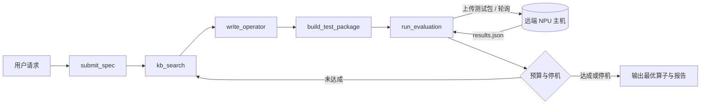

# CANNESS

**面向昇腾 CANN 算子开发的智能体插件** —— 以 [DeepSeek Harness](https://github.com/deepseek-ai/deepseek-harness)（下称 dsh）插件形式交付。

把「提交规格书 → 生成四层算子 → 打测试包 → 上传远端 → 等待评测 → 按预算续轮」这条闭环，交给 dsh 的 agent loop 驱动；CANNESS 只负责其中的领域契约。

[](CHANGELOG.md)
[](LICENSE)
[](https://nodejs.org/)
[](https://github.com/deepseek-ai/deepseek-harness)
[](plugin/tests)

**简体中文** | [English](README.en.md)

---

## 目录

- [1. 为什么需要 CANNESS](#1-为什么需要-canness)
- [2. 特性](#2-特性)
- [3. 架构](#3-架构)
- [4. 一次完整回合](#4-一次完整回合)
- [5. 环境要求](#5-环境要求)
- [6. 快速开始](#6-快速开始)
- [7. 工具参考](#7-工具参考)
- [8. 配置参考](#8-配置参考)
- [9. 远端约定](#9-远端约定)
- [10. 认证与凭据](#10-认证与凭据)
- [11. 工作区结构](#11-工作区结构)
- [12. 开发](#12-开发)
- [13. 已知限制与路线图](#13-已知限制与路线图)
- [14. 常见问题](#14-常见问题)
- [15. 文档](#15-文档)
- [16. 许可](#16-许可)

## 1. 为什么需要 CANNESS

昇腾算子开发（AscendC）的循环很长：写规格书 → 实现 kernel / host / api / plugin 四层 → 编译 → 精度与性能验证 → 读 msprof 数据 → 改代码。真正昂贵的不是某一次编译，而是**每一轮都要人工搬运和判断**：复制文件、登录机器、等结果、读懂日志、决定下一步改哪里。

CANNESS 把这个循环交给智能体，但把边界划得很清楚：

| 归属 | 负责什么 |
|---|---|
| **dsh** | CLI、配置、LLM 路由、agent 编排、会话日志、Web UI、凭据存储 |
| **CANNESS 插件** | 领域契约：规格书、四层文件、测试包、评估报告、知识库、迭代预算 |
| **远端主机** | 真正跑编译、精度校验、性能采集与 msprof |

本地**不编译算子、不调用 CANN、不调用任何云 API**。评测只发生在你自己那台装了 CANN 工具链的机器上，CANNESS 对它只有一个要求：能 SSH 登录。inbox 的消费者由 `run_evaluation` 首次自举（见 [9.1](#91-目录布局)）；主机侧已有真实 runner 时也可以关掉自举。

## 2. 特性

- **规格书驱动** —— `submit_spec` 逐字段校验；缺字段直接失败并给出字段路径，由模型回头追问用户，不写半成品状态。
- **四层落盘** —— `write_operator` 一次写入 `op_kernel` / `op_host` / `op_api` / `op_plugin` 四个文件。
- **测试包自包含** —— `build_test_package` 复制四层文件并生成 `manifest.json`，远端拿到即可编译。
- **通用 SSH 传输** —— 基于 `ssh2` 的 SFTP 上传 + 结果轮询；私钥与密码两种认证，密码走 dsh 凭据存储。
- **预算与停机** —— 有效迭代、编译重试、超时、性能连续变差、收敛、目标达成，六类条件独立判定。
- **自动续轮** —— `canness-loop` 在 `agent/turn-stopping` 处 `steer` 一轮带评测上下文的增强块，不需要用户手动催。
- **性能分析内建** —— 解析 msprof 形状的 `analysis`（瓶颈类型、MAC/MTE2/Scalar 比例、cube 利用率），失败原因直接进提示。
- **Web 设置卡** —— 设置 → CANNESS，改主机、路径、预算后保存即生效（volatile 配置），不用重启。
- **可重放** —— 每轮工具入参与结果都进 dsh 会话日志，「模型可见即已记录」。

## 3. 架构

```
┌───────────────────────────── dsh (deepseek-harness) ─────────────────────────────┐
│  CLI · 配置分层 · LLM 路由 · 会话日志 · Web UI · 凭据存储                        │
│                                                                                  │
│  agent loop ──► tool pipeline ──► 事件总线（agent/pre-step、agent/turn-stopping）│
│  工具注册 · 配置热更新 · 会话日志 · 凭据存储                                     │
└────────────────────────────────────────▲─────────────────────────────────────────┘
                                         │  工具调用 / 工具结果 / 事件
┌────────────────────────────────────────┴─────────────────────────────────────────┐
│ dsh-canness（bundle）                                                            │
│                                                                                  │
│  canness-knowledge  ──► kb_search                                                │
│  canness-generator  ──► submit_spec · write_operator · build_test_package        │
│  canness-eval       ──► run_evaluation ──── SFTP ────► 远端 NPU 主机             │
│  canness-loop       ──► 预算与停机策略（两个事件监听器）                         │
│  canness (client)   ──► Web 设置卡                                               │
└──────────────────────────────────────────────────────────────────────────────────┘
```

### 插件清单

| 插件 id | 入口 | 注册的工具 | 监听的事件 |
|---|---|---|---|
| `canness` | `dsh-canness` | — | — （只作为浏览器半区的挂载行） |
| `canness-knowledge` | `dsh-canness/knowledge` | `kb_search` | — |
| `canness-generator` | `dsh-canness/generator` | `submit_spec`、`write_operator`、`build_test_package` | — |
| `canness-eval` | `dsh-canness/eval` | `run_evaluation` | — |
| `canness-loop` | `dsh-canness/loop` | — | `agent/pre-step`、`agent/turn-stopping` |

四个 host 插件共享 `{workspace}/.canness/state.json`；`canness` 这一行本身没有逻辑，但浏览器半区只挂在裸包名那一行上，删掉它设置卡就不会出现。

### 控制权划分

模型只决定「下一步做什么」，三类闸门都在代码里：

| 闸门 | 载体 | 作用 |
|---|---|---|
| 工具校验 | 工具参数 schema | 什么能做（例如未 `submit_spec` 不允许 `write_operator`） |
| 事件监听 | `agent/pre-step` / `agent/turn-stopping` | 注入什么上下文、要不要再跑一轮 |
| 服务内规则 | `policy.ts` | 什么算一次有效迭代、什么时候停 |

## 4. 一次完整回合



1. 用户提出需求：「Add，float16，910B，kernel_time ≤ 8us」。
2. `submit_spec` 校验规格书，生成 `generationId`（形如 `gen-1a2b3c4d`）并写状态文件。
3. `kb_search` 按算子名检索知识库，拿回参考实现与 tiling 提示。
4. `write_operator` 把四层文件写到 `{workspace}/operators/<generationId>/`。
5. `build_test_package` 组装 `{workspace}/packages/<generationId>/`，附 `manifest.json`。
6. `run_evaluation` 上传到 `{inbox}/<generationId>/`，轮询 `{outbox}/<generationId>/results.json`，解析为评估报告作为工具结果返回。
7. `canness-loop` 依据报告与预算决定 `steer` 下一轮还是结束，并把失败上下文拼进增强块。

## 5. 环境要求

| 依赖 | 版本 | 说明 |
|---|---|---|
| Node.js | `>= 24.9.0` | 插件运行时 |
| pnpm | `>= 10` | 实测 `11.28.5` |
| dsh | `>= 0.2.0 < 0.3.0` | 对照版本 `0.2.1-rc.3` |
| 远端主机（可选） | Linux + sshd | 真实 CANN / msprof 可选；只跑 mock 时不需要 CANN |

dsh 有两种来源，任选一种，下文分别给出命令：

- **已安装的 CLI**：`dsh ...`
- **dsh 源码仓库**：`pnpm dsh ...`，需先在该仓库执行 `pnpm install && pnpm run build`

> **Windows** 建议使用 Git Bash。`dsh plugin add` 同时接受相对路径与绝对路径，本文统一使用绝对路径以免歧义。

## 6. 快速开始

五个步骤：构建插件 → 准备 profile → 固定绝对路径 → 启动 → 验证。

### 6.1 克隆并构建插件

```bash
git clone https://github.com/Hanerson/CANNESS.git
cd CANNESS/plugin
pnpm install
pnpm test
pnpm build
```

`pnpm build` 会编译 host 半区（`lib/*.js`）并用 esbuild 打包浏览器半区（`lib/client.js`）。dsh 加载的是 `lib/`，**改完源码必须重新 build**。`lib/` 与 `node_modules/` 已在 `.gitignore` 中，克隆后必须自行构建。

### 6.2 准备一个带 Web 界面的 profile

dsh 的「安装插件」= 把包链接进某个 profile，并把包名写进该 profile 的 `dsh.profile.bundles`。`dsh plugin add` 两件事一起做。

先建一个以 `web` 为模板的专用 profile（`canness-web`）：

```bash
# 已安装的 dsh
dsh --profile canness-web --from-default-profile web --dump-config

# 或：dsh 源码仓库根目录
pnpm dsh --profile canness-web --from-default-profile web --dump-config
```

`--dump-config` 只创建 profile 并打印组合结果，不启动服务。

然后安装插件（把路径换成你的克隆位置）：

```bash
# 已安装的 dsh
dsh plugin --profile canness-web add /abs/path/to/CANNESS/plugin

# 或：dsh 源码仓库根目录
pnpm dsh plugin --profile canness-web add /abs/path/to/CANNESS/plugin
```

Windows 示例：

```bash
pnpm dsh plugin --profile canness-web add D:/projects/CANNESS/plugin
```

安装成功后，`~/.dsh/profiles/canness-web/package.json` 的 `bundles` 应包含 `dsh-canness`：

```json
["@deepseek-ai/dsh-base", "@deepseek-ai/dsh-web-app", "dsh-canness"]
```

> pnpm 会打印 peerDependencies 警告，这是正常的：这些 peer 由 dsh 运行时提供，不需要装进 profile。

### 6.3 在 profile 层固定绝对路径

bundle 自带的 [`plugin/cordis.patch.yml`](plugin/cordis.patch.yml) 使用相对路径：

```yaml
kbRoot: ./plugin/knowledge_base
workspace: ./canness-workspace
```

它们按 **dsh 进程的 cwd** 解析。从别处启动会指错目录，所以把下面这段写进 `~/.dsh/profiles/canness-web/cordis.patch.yml`（路径换成你的仓库位置）：

```yaml
# dsh 的 patch 会替换目标行的整个 config，因此每个键都要重述。
- id: canness-knowledge
  config:
    kbRoot: D:/projects/CANNESS/plugin/knowledge_base

- id: canness-generator
  config:
    workspace: D:/projects/CANNESS/canness-workspace

- id: canness-eval
  config:
    workspace: D:/projects/CANNESS/canness-workspace
    host: ''
    port: 22
    username: ''
    privateKeyPath: ''
    inbox: /tmp/canness/inbox
    outbox: /tmp/canness/outbox
    timeoutSec: 1800
    pollIntervalMs: 2000
    maxIterations: 10
    maxCompileRetries: 3
    negativeStreakLimit: 3
    convergenceThreshold: 0.05

- id: canness-loop
  config:
    workspace: D:/projects/CANNESS/canness-workspace
    maxIterations: 10
    maxCompileRetries: 3
    negativeStreakLimit: 3
    convergenceThreshold: 0.05
```

`canness-workspace/` 会在第一次生成算子时自动创建。也可以不写这份文件，改在 6.4 启动后的 **设置 → CANNESS** 卡片里填 —— 卡片保存的就是这份 patch。

### 6.4 启动

```bash
# 已安装的 dsh
dsh --profile canness-web

# 或：dsh 源码仓库根目录
pnpm dsh canness-web
```

终端会打印 `dsh web: http://127.0.0.1:<port>/?token=...`，用浏览器打开即可。常用参数：`--no-open` 不自动开浏览器，`--port 0` 由系统选空闲端口，`--host 127.0.0.1` 指定绑定地址。

### 6.5 验证

```bash
dsh --profile canness-web --dump-config | grep -A 8 "== dsh-canness"
```

应看到五行：`canness`、`canness-knowledge`、`canness-generator`、`canness-eval`、`canness-loop`。

启动后，**设置 → CANNESS** 应出现设置卡；对话里让模型调用 `kb_search` 等工具即可确认插件已加载。

## 7. 工具参考

### `kb_search`

| 参数 | 类型 | 必填 | 说明 |
|---|---|---|---|
| `operator_name` | string | 是 | 算子名，例如 `Add` |

返回匹配条目的正文合并文本，上限 8000 字符。匹配方式是**文件名包含**（忽略大小写），例如 `Add.md`。没有命中时返回 `no knowledge entry for <name>`。

### `submit_spec`

| 参数 | 类型 | 必填 | 说明 |
|---|---|---|---|
| `spec` | JSON | 是 | 算子规格书 |

返回 `{ generationId, operator_name }`。校验失败会抛出 `missing <字段路径>`，例如 `missing performance_target.metric`，不写状态文件。

规格书结构：

```json
{
  "operator_name": "Add",
  "operator_type": "elementwise",
  "input_specs": [
    { "name": "x", "shape": ["B", "N"], "dtype": "float16" },
    { "name": "y", "shape": ["B", "N"], "dtype": "float16" }
  ],
  "output_specs": [
    { "name": "z", "shape": ["B", "N"], "dtype": "float16" }
  ],
  "target_platform": { "chip": "Ascend910B", "soc_version": "Ascend910B4" },
  "performance_target": { "metric": "kernel_time", "target_us": 8 },
  "tiling_hints": "B*N 按 8192 分块，UB 内双缓冲"
}
```

| 字段 | 必填 | 约束 |
|---|---|---|
| `operator_name` / `operator_type` | 是 | 非空字符串 |
| `input_specs` / `output_specs` | 是 | 非空数组；每项含 `name`、`shape`（字符串数组）、`dtype`，`constraints` 可选 |
| `target_platform.chip` | 是 | 非空字符串；`soc_version`、`cann_version` 可选 |
| `performance_target.metric` | 是 | 目前只接受 `kernel_time` |
| `performance_target.target_us` | 是 | 有限正数 |
| `tiling_hints` | 否 | 字符串或 `null` |

### `write_operator`

| 参数 | 类型 | 必填 | 说明 |
|---|---|---|---|
| `kernel` | string | 是 | `op_kernel/kernel.cpp` 内容 |
| `host` | string | 是 | `op_host/host.cpp` 内容 |
| `api` | string | 是 | `op_api/api.cpp` 内容 |
| `plugin` | string | 是 | `op_plugin/plugin.py` 内容 |

返回 `{ operatorDir }`。未调用 `submit_spec` 时报 `submit_spec first`。

### `build_test_package`

无参数。返回 `{ packageDir }`。复制当前 generation 的四层文件并写入 `manifest.json`：

```json
{
  "generationId": "gen-1a2b3c4d",
  "operatorName": "Add",
  "performanceTargetUs": 8,
  "files": ["op_kernel/kernel.cpp", "op_host/host.cpp", "op_api/api.cpp", "op_plugin/plugin.py"]
}
```

### `run_evaluation`

无参数。返回一份评估报告（结构见 [9.2](#92-结果文件)）。以下情况**不抛异常**，而是返回 `status: "error"` 的报告：`host` 为空、凭据缺失、SSH 连接失败、远端自举失败、预算已耗尽。以下情况抛异常：未 `submit_spec`（`submit_spec first`）、未 `build_test_package`（`build_test_package first`）。

## 8. 配置参考

四个 host 插件各自的配置。除 `workspace` 外，`canness-eval` 的字段都是 **volatile** —— 设置卡保存后下一次操作立即读到新值，无需重启。

### `canness-knowledge`

| 字段 | 类型 | 说明 |
|---|---|---|
| `kbRoot` | string | 知识库目录。bundle 默认 `./plugin/knowledge_base` |

### `canness-generator`

| 字段 | 类型 | 说明 |
|---|---|---|
| `workspace` | string | 工作区根目录，状态文件与产物写在这里 |

### `canness-eval`

| 字段 | 类型 | 默认 | 说明 |
|---|---|---|---|
| `workspace` | string | — | 工作区根目录 |
| `host` | string | `""` | 远端主机名或 IP；为空时 `run_evaluation` 直接返回错误报告 |
| `port` | number | `22` | SSH 端口 |
| `username` | string | `""` | SSH 用户名 |
| `privateKeyPath` | string | `""` | 私钥文件路径；非空时优先用它认证 |
| `passwordEnv` | string | `CANNNESS_SSH_PASSWORD` | 凭据存储中的引用名，用于取 SSH 密码 |
| `inbox` | string | `/tmp/canness/inbox` | 远端接收测试包的目录 |
| `outbox` | string | `/tmp/canness/outbox` | 远端写回结果的目录 |
| `timeoutSec` | number | `1800` | 等待 `results.json` 的最长秒数 |
| `pollIntervalMs` | number | `2000` | 两次轮询之间的间隔 |
| `maxIterations` | number | `10` | 有效迭代上限 |
| `maxCompileRetries` | number | `3` | 编译失败累计上限 |
| `negativeStreakLimit` | number | `3` | 性能连续变差上限 |
| `convergenceThreshold` | number | `0.05` | 两次通过结果的相对差小于该值即判收敛 |
| `bootstrap` | boolean | `true` | 首次上传前做远端自举：建目录、探测/补齐 inbox 消费者；设 `false` 则完全不介入远端 |
| `bootstrapCommand` | string | `""` | 非空时执行该 POSIX 命令作为消费者启动方式（要求退出码 0），不再部署内置 mock |

### `canness-loop`

`workspace` 加与 `canness-eval` 同名的四个预算字段。

> **预算字段写两份，数字必须一致。** `canness-eval` 用它们拒绝超预算调用并判定停机，`canness-loop` 用它们决定要不要 `steer`。两处不一致会出现「工具拒绝执行但循环仍在续轮」的错位。

### 停机条件

| 条件 | 触发阈值 | `lastReport.summary` |
|---|---|---|
| 超时累计 | `timeouts >= 2`（固定值） | `stopped: timeouts` |
| 编译失败累计 | `compileRetries >= maxCompileRetries` | `stopped: compileRetries` |
| 有效迭代 | `validIterations >= maxIterations` | `stopped: maxIterations` |
| 性能连续变差 | `negativeStreak >= negativeStreakLimit` | `stopped: negativeStreak` |
| 收敛 | 两次通过结果相对差 `< convergenceThreshold` | `stopped: converged` |
| 目标达成 | `kernelTimeUs <= targetUs`（最近一次为 `pass`） | `stopped: targetMet` |

### 计数规则

| 报告状态 | 有效迭代 | 其它计数 |
|---|---|---|
| `compile_fail` | 不增加 | `compileRetries + 1` |
| `timeout` | 不增加 | `timeouts + 1` |
| `pass` | +1 | `negativeStreak` 归零，记录最近与上一轮通过用时、刷新最优 |
| `accuracy_fail` / `perf_fail` / `error` | +1 | 用时优于历史最优则刷新最优并归零 streak，否则 `negativeStreak + 1` |

## 9. 远端约定

### 9.1 目录布局

```
{inbox}/{generationId}/op_kernel/kernel.cpp
{inbox}/{generationId}/op_host/host.cpp
{inbox}/{generationId}/op_api/api.cpp
{inbox}/{generationId}/op_plugin/plugin.py
{inbox}/{generationId}/manifest.json

{outbox}/{generationId}/results.json
```

`run_evaluation` 每轮会先删除上一次的 `results.json` 再开始轮询，避免读到陈结果。

**inbox 的消费者在首次调用时自举。** `run_evaluation` 会先建 `{baseDir}`（= `dirname(inbox)`）、`inbox`、`outbox`，再复用已在运行的消费者（`{baseDir}/watch.pid` 里的 pid 存活，或 `pgrep` 命中 `watch.py`）；都没有时上传插件包里的 `remote/watch.py`（已存在则不覆盖）并用 `nohup … --loop` 启动，pid 与日志落在 `{baseDir}`。这是插件唯一一次通过 SSH 执行命令：编译与评测仍由主机侧 runner 负责；已有真实 runner 的机器设 `bootstrapCommand` 或 `bootstrap: false` 即可完全不介入。

自举任一步失败（目录权限、远端没有 python、`bootstrapCommand` 非 0 退出、进程起不来）时不会进入轮询，而是在数秒内返回 `status: "error"`、`summary` 为 `remote bootstrap failed: <原因>`；修好配置后重试即可，这次失败不消耗迭代预算。

### 9.2 结果文件

```json
{
  "generationId": "gen-1a2b3c4d",
  "status": "pass",
  "compile": { "ok": true, "log": "" },
  "correctness": { "ok": true, "maxRelativeError": 0.0004 },
  "performance": { "kernelTimeUs": 7.6, "targetUs": 8 },
  "analysis": {
    "source": "msprof",
    "bottleneck": "memory",
    "summary": "Task Duration 7.6us；aic_mte2_ratio 0.71，内存搬运为主，cube_utilization 21.3%。",
    "op": {
      "opName": "Add",
      "opType": "Add",
      "taskType": "AI_CORE",
      "taskDurationUs": 7.6,
      "taskWaitTimeUs": 2,
      "blockDim": 8,
      "aicoreTimeUs": 7.6,
      "aicMacRatio": 0.12,
      "aicMte2Ratio": 0.71,
      "aicScalarRatio": 0.09,
      "cubeUtilizationPct": 21.3
    }
  },
  "summary": "passed"
}
```

| 字段 | 约束 |
|---|---|
| `status` | 六选一：`pass`、`compile_fail`、`accuracy_fail`、`perf_fail`、`timeout`、`error` |
| `compile` | `ok` 布尔，`log` 字符串（进入增强块时截断到 2000 字符） |
| `correctness.maxRelativeError` | 数字或 `null` |
| `performance.kernelTimeUs` / `targetUs` | 数字或 `null` |
| `analysis` | 可为 `null`；`source` ∈ `msprof`、`msprof-mock`；`bottleneck` ∈ `cube`、`memory`、`scalar`、`unknown`；`op` 可为 `null` |

字段不合法时不会抛错，而是返回 `status: "error"`、`summary` 为 `malformed result: <原因>` 的报告，让闭环继续跑而不是中断。

### 9.3 远端 mock

没有 CANN 环境时，用 [`plugin/remote/watch.py`](plugin/remote/watch.py) 模拟评测。空白主机的第一次 `run_evaluation` 会自动部署该脚本并以 `--loop` 拉起（见 [9.1](#91-目录布局)）；关掉自举或想手动补跑时，用 cron 或手动执行：

```bash
python3 watch.py --inbox /tmp/canness/inbox --outbox /tmp/canness/outbox --once
```

它扫描 `{inbox}/*/manifest.json`，为每个 generation 写一份 `status: "pass"`、`analysis.source: "msprof-mock"` 的 `results.json`，`kernelTimeUs` 取 `manifest` 里的 `performanceTargetUs`。不调用 msprof，也不改已有结果文件。

## 10. 认证与凭据

`run_evaluation` 的认证优先级：

1. 配置了 `privateKeyPath` → 用私钥；
2. 否则从 dsh 凭据存储解析 `passwordEnv`（默认 `CANNNESS_SSH_PASSWORD`）→ 用密码；
3. 都没有 → 返回 `ssh credentials missing` 的错误报告。

存密码有两种方式：

- **Web UI（推荐）** —— 设置 → CANNESS → 打开「使用密码认证」，填入密码后保存。密码写入 `~/.dsh/.credentials.yaml`，**不进入任何配置文件**，也不会回显。
- **环境变量** —— `CANNNESS_SSH_PASSWORD=... dsh --profile canness-web`。环境变量是凭据存储的回退层。

> 卡片上的「使用密码认证」开关只决定显示哪个输入框，服务端优先级始终是私钥优先。两者都配置时以私钥为准。

## 11. 工作区结构

```
{workspace}/
├── .canness/
│   └── state.json                 # 当前 generation、规格书、计数、最近一次报告
├── operators/
│   └── <generationId>/            # 四层算子文件
│       ├── op_kernel/kernel.cpp
│       ├── op_host/host.cpp
│       ├── op_api/api.cpp
│       └── op_plugin/plugin.py
└── packages/
    └── <generationId>/            # 测试包：四层文件 + manifest.json
```

`state.json` 字段：

| 字段 | 说明 |
|---|---|
| `generationId` | 当前轮次 id，由 `submit_spec` 生成 |
| `spec` | 规格书原文 |
| `validIterations` | 有效迭代计数 |
| `compileRetries` | 编译失败累计 |
| `timeouts` | 超时累计 |
| `negativeStreak` | 性能连续变差计数 |
| `bestKernelTimeUs` | 历史最优 kernel 用时 |
| `previousPassKernelTimeUs` / `lastPassKernelTimeUs` | 最近两次通过用时，用于收敛判定 |
| `lastReport` | 最近一次评估报告 |

删掉 `state.json` 等于重开一局；`operators/` 与 `packages/` 可以随意清理。

## 12. 开发

```bash
cd plugin
pnpm test     # Vitest，11 个文件 / 51 个用例
pnpm check    # host + client 两份 tsconfig 类型检查
pnpm build    # tsc + esbuild，产出 lib/
```

开发循环：

1. 改 `plugin/src/`；
2. `pnpm test && pnpm check && pnpm build`；
3. 重启 dsh（patch 配置会热加载，模块代码不会）。

profile 里装的是**符号链接**，指向 `plugin/` 目录，所以不需要反复 `plugin add`；但**必须重新 `pnpm build`**，dsh 才能看到新的 `lib/`。

### 目录结构

```
CANNESS/
├── plugin/                        # npm 包 dsh-canness
│   ├── src/                       # host 半区
│   │   ├── index.ts               # 裸包名入口（浏览器半区的挂载行）
│   │   ├── knowledge.ts           # kb_search
│   │   ├── knowledge-search.ts    # 文件级检索
│   │   ├── generator.ts           # submit_spec / write_operator / build_test_package
│   │   ├── spec.ts                # 规格书校验
│   │   ├── package-files.ts       # 四层落盘与测试包
│   │   ├── eval.ts                # run_evaluation
│   │   ├── eval-run.ts            # 上传 → 轮询 → 解析
│   │   ├── ssh2-transport.ts      # ssh2 SFTP 适配
│   │   ├── remote.ts              # RemoteFiles 接口 + 内存实现
│   │   ├── report.ts              # 评估报告结构与解析
│   │   ├── analysis.ts            # msprof 形状的性能分析
│   │   ├── policy.ts              # 计数、停机、增强块
│   │   ├── loop.ts                # 两个事件监听器
│   │   ├── state-file.ts          # state.json 读写
│   │   ├── ids.ts                 # generationId
│   │   └── client/                # 浏览器半区（Web 设置卡）
│   ├── tests/                     # Vitest 单元测试
│   ├── knowledge_base/            # 知识库条目
│   ├── remote/watch.py            # 远端 mock 结果生成器
│   ├── scripts/build-client.mjs   # 浏览器半区打包脚本
│   ├── cordis.patch.yml           # bundle 默认配置层
│   └── package.json
├── docs/
│   ├── design/                    # 01–05 设计文档，05 为实施基准
│   └── plans/                     # 实现计划与提案
├── .github/workflows/ci.yml       # CI：check + test + build
├── CHANGELOG.md
├── LICENSE
├── README.md                      # 本文件
└── README.en.md
```

### 约束

- 插件代码只能是 **TypeScript / ESM**；Python 只出现在 `remote/watch.py` 与知识库正文里。
- 浏览器半区只能 value-import dsh 冻结模块表里的包（`react`、`cordis`、`dsh-client-*` 等），其余由 esbuild 内联。
- 预算四字段在 `canness-eval` 与 `canness-loop` 各写一份，两处数字必须相同。
- 新增工具或字段时同步更新 [docs/design/05-plugin-architecture.md](docs/design/05-plugin-architecture.md) 与 README 的配置表。

### 测试策略

- `remote.ts` 的 `MemoryRemote` 让上传 / 轮询 / 超时可以在内存里跑完整回合，不需要网络。
- `ssh2-transport.ts` 通过 `Dial` 注入点替换真实连接，只验协议组装与错误映射。
- `policy.ts` 的计数与停机是纯函数，覆盖每个停机分支。
- 设置卡用 `SettingFormModel` 的假 scope 驱动，不启动浏览器。

## 13. 已知限制与路线图

### 当前限制

- **单轮单候选**：一次生成一个算子，没有并行候选、tiling 搜索、融合策略。
- **只支持通用 SSH**：本地执行器、华为云、CANN Lab 等后端均已取消；远端怎么启动编译是主机侧的事。
- **知识库是文件级检索**：文件名匹配 + 正文截断，没有向量检索或结构化索引。
- **没有 Dashboard**：迭代历史看会话日志与 `state.json`。
- **真实主机验收未完成**：单元测试覆盖了协议与策略，但真实 SSH 主机 + 真实 CANN 工具链的端到端验证还没做。

### 路线图

| 阶段 | 目标 |
|---|---|
| v0.1（当前） | 打通单个算子的完整闭环，mock 与真实主机可切换 |
| v0.2 | 真实主机端到端验收；失败分类细化；增强块按失败类型分化 |
| v0.3 | 知识库结构化索引；参考实现与 tiling 模板自动注入 |
| 之后 | 并行候选、搜索、Dashboard、更多算子类型 |

## 14. 常见问题

**Q：`dsh web --patch ./plugin/cordis.patch.yml` 报 `Cannot find package 'dsh-canness'`？**

`--patch` 只贡献配置行，模块解析仍发生在 profile 目录。这个包有多个子路径入口，必须先 `dsh plugin add` 进对应 profile。

**Q：`pnpm dsh canness` 启动了但没有任何界面？**

只含 `dsh-base + dsh-canness` 的 profile 没有 app 层。用本文的 `canness-web`（以 `web` 为模板），或给 profile 的 bundles 补 `@deepseek-ai/dsh-web-app`。

**Q：知识库搜不到 / 工作区写到了奇怪的位置？**

bundle 默认的相对路径按 dsh 进程 cwd 解析。按 [6.3](#63-在-profile-层固定绝对路径) 在 profile 的 `cordis.patch.yml` 里写绝对路径。

**Q：启动时报 `Cannot find module .../lib/index.js`？**

没有构建。在 `plugin/` 下执行 `pnpm build`。

**Q：`run_evaluation` 一直等到超时？**

先看报告 `summary`：以 `remote bootstrap failed: ` 开头时按原因修配置（目录权限、远端缺 python、`bootstrapCommand` 退出码）；其余情况多半是 `outbox` 路径与消费者写出的位置不一致，用 `watch.py --once` 手动确认路径。

**Q：pnpm 警告 peerDependencies 未解析？**

正常。dsh 运行时提供这些 peer，`plugin add` 使用链接安装，不会把 peer 装进 profile。

**Q：dsh 版本不满足 `engines.dsh`？**

插件声明 `>=0.2.0 <0.3.0`。换用 `0.2.1-rc.3` 附近的 dsh，或同步修改 `plugin/package.json` 的 `engines.dsh` 与 peer 版本。

## 15. 文档

| 文档 | 内容 |
|---|---|
| [docs/README.md](docs/README.md) | 文档索引与阅读路径 |
| [docs/design/05-plugin-architecture.md](docs/design/05-plugin-architecture.md) | **实施基准**：插件边界、工具契约、事件映射、技术栈 |
| [docs/design/01–04](docs/design/) | 总体设计、详细架构、闭环反馈方法论、可行性评估 |
| [docs/plans/](docs/plans/) | MVP 实现计划、SSH 凭据设计提案与实现计划 |
| [plugin/README.md](plugin/README.md) | 包级说明：构建、profile 安装、远端 |
| [CHANGELOG.md](CHANGELOG.md) | 版本记录 |

`01`–`04` 是插件化改造前的设计，其中 CLI、配置、编排、LLM 层的结论已被 `05` 取代；读 `05` 时不必先读它们。

## 16. 许可

[MIT](LICENSE) © 2026 CANNESS Contributors

---

本项目源于南京大学大学生创新训练计划「基于大模型智能体的软件开发系统 / 多智能体的垂域软件开发」。
